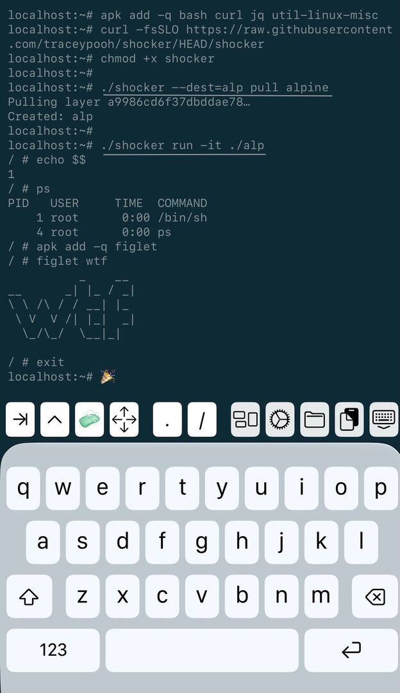

# shocker
Docker implemented in around 300 lines of bash ⚡️

Fork of bocker (github.com/p8952/bocker). updated & expanded for 2026.

  * [Prerequisites](#prerequisites)
  * [Example Usage](#example-usage)
  * [Functionality: Currently Implemented](#functionality-currently-implemented)
  * [2026 Modernization](#2026-modernization)
    * [What broke in bocker and what shocker fixes](#what-broke-in-bocker-and-what-shocker-fixes)
    * [Second pass of fixes/improvements](#second-pass-of-fixesimprovements)
    * [Third pass of fixes](#third-pass-of-fixes)
    * [Fourth pass of fixes/improvements](#fourth-pass-of-fixesimprovements)
    * [Fifth pass of fixes/improvements](#fifth-pass-of-fixesimprovements)
    * [Sixth pass of fixes/improvements](#sixth-pass-of-fixesimprovements)
  * [btrfs /var/shocker setup](#btrfs-varshocker-setup)
  * [Building images](#building-images)
  * [proxy / private registry](#proxy--private-registry)
  * [Functionality: Not Yet Implemented](#functionality-not-yet-implemented)
  * [License](#license)
  * [Control Groups (cgroups)](#control-groups-cgroups)
  * [More crazy? shocker-in-shocker](#more-crazy--shocker-in-shocker)
  * [Understanding containers from scratch](#understanding-containers-from-scratch)
  * [Using shocker on a mac](#using-shocker-on-a-mac)
  * [pull & run: no btrfs/overlay required](#pull--run-no-btrfsoverlay-required)
  * [Using shocker on iOS (iSH)](#using-shocker-on-ios-ish)


## Prerequisites

The following packages are needed to run shocker.

* btrfs-progs
* curl
* jq
* iproute2
* iptables
* util-linux
* coreutils
* bash

Additionally your system will need or gets configured with the following:

* A `btrfs` filesystem mounted under `/var/shocker` (see below for setup help)
* A network bridge called `bridge0` and an IP of 10.0.0.1/24 (gets created if missing)
* IP forwarding enabled in `/proc/sys/net/ipv4/ip_forward` (gets created if missing)
* `iptables` NAT and FORWARD rules for `bridge0` (gets created if missing)

You probably still want to **run shocker in a virtual machine**. `shocker` runs as `root` and among other things, makes changes to your network interfaces, routing table, and firewall rules.

**We can make no guarantees that it won't trash your system**.


## Example Usage

```sh
> shocker pull alpine
Pulling layer 6a0ac1617861a677b04…
Created: img-aa090

> shocker images
IMAGE_ID		SOURCE
img-aa090		alpine:latest

> shocker run alpine cat /etc/issue
Welcome to Alpine Linux 3.23
Kernel \r on \m (\l)

> shocker ps
CONTAINER_ID		COMMAND
ps-58122		cat /etc/issue

> shocker logs ps-58122
Welcome to Alpine Linux 3.23
Kernel \r on \m (\l)

> shocker rm ps-58122
Removed: ps-58122

> shocker run --rm alpine curl
/bin/sh: curl: not found

> shocker run alpine apk add curl
(1/9) Installing brotli-libs (1.2.0-r0)
(2/9) Installing c-ares (1.34.6-r0)
(3/9) Installing libunistring (1.4.1-r0)
(4/9) Installing libidn2 (2.3.8-r0)
(5/9) Installing nghttp2-libs (1.69.0-r0)
(6/9) Installing libpsl (0.21.5-r3)
(7/9) Installing zstd-libs (1.5.7-r2)
(8/9) Installing libcurl (8.19.0-r0)
(9/9) Installing curl (8.19.0-r0)
Executing busybox-1.37.0-r30.trigger
OK: 13.0 MiB in 25 packages

> shocker ps
CONTAINER_ID		COMMAND
ps-19998		apk add curl

> shocker commit ps-19998 img-aa090
Removed: img-aa090
Created: img-aa090

> shocker run --rm img-aa090 which curl
/usr/bin/curl

> shocker run --rm -it img-aa090
/ # ls
bin   etc   img.source   media   opt    ps-19998.cmd  ps-ab245.cmd  run     srv   tmp   var
dev   home  lib          mnt     proc   ps-19998.log  root          sbin    sys   usr
/ # date
Fri May 22 23:54:38 UTC 2026
/ # exit
```


## Functionality: Currently Implemented

* `docker build` †
* `docker pull`
* `docker images`
* `docker ps`
* `docker run`
* `docker exec`
* `docker logs`
* `docker commit`
* `docker rm` / `docker rmi`
* Networking
* Quota Support / CGroups

† `shocker init` is a `docker import` equivalent — it promotes a local directory into a shocker image. For a proper build workflow, see [Building images](#building-images) below.


## 2026 Modernization
### What broke in bocker and what shocker fixes
- `shocker_pull` → full rewrite for Registry v2
  - The original used Docker's v1 registry API (`index.docker.io/v1/`), which was shut down in 2023. Shocker uses the v2 API with proper OAuth2 Bearer token auth, fetches the manifest (accepting both Docker schema v2 and OCI formats), extracts layer digests, and pulls blobs by digest.
- `cgroups v1 → v2 support`
  - Most modern distros (Ubuntu 22.04+, Fedora 31+, etc.) ship with cgroups v2 unified hierarchy. The original's cgcreate/cgset/cgexec/cgdelete commands only work with v1. Shocker detects the version at startup and uses either:
  - v2: writes directly to `/sys/fs/cgroup/`, maps `cpu.shares` → `cpu.weight`, `memory.limit_in_bytes` → `memory.max`
  - v1: falls back to the original cgroup-tools commands
- UUID space expansion
  - bocker used `shuf -i 42002-42254` — only 252 possible values, almost guaranteed collision if you run a few containers. shocker uses 5 hex digits `($RANDOM * $RANDOM % 0xFFFFF)` = ~1 million values.
- MAC address generation
  - The original's `02:42:ac:11:00$mac` was only a 2-octet suffix from 3 decimal digits, producing malformed MACs. shocker derives a proper 6-octet MAC from 4 hex chars of the UUID.
- `shocker_exec PID` lookup
  - The original's nested `ps | grep | awk | grep` pipeline was fragile and often broke. Replaced with a single `ps -eo pid,args | awk` that matches the unshare process for the container UUID.

### Second pass of fixes/improvements
- **IP derivation** — now uses the full 5-hex-digit UUID value (`16#${uuid} % 253`) rather than just the last 2 hex digits, significantly reducing the chance of two containers getting the same IP
- **MAC address** — zero-pads the UUID to 8 hex digits with `printf '%08x'` then slices into 4 clean `xx` octets; fixes potential truncation with short UUID values and removes fragile `sed` regex
- **`shocker_pull` — manifest list handling** — now accepts manifest list / OCI image index media types, detects which type was returned, then resolves to the correct platform digest (matching `uname -m` normalized to OCI arch names: `amd64`, `arm64`, `arm`) before fetching the actual image manifest; fixes accidentally pulling layers for the wrong architecture
- **`shocker_pull` — config blob fix** — switched from `grep` on raw JSON to `python3` parsing `layers[]` explicitly; the config blob lives under `config` not `layers`, so the old grep was incorrectly including it and causing `tar` to fail on a non-tarball

### Third pass of fixes
- Default tag to `:latest` when omitted
- Registry v2 API with multi-arch manifest list support
- `SHOCKER_REGISTRY` env var for Nexus/mirror pull-through (see below)
- Two-step CDN blob download to work around proxy allowlists
- `btrfs` check with setup instructions (see below)
- `bridge0` + NAT auto-created on first run
- cgroups v2 support with proper quoting in `_cg_exec`
- --mount-proc=<path> fix for proc inside chroot

### Fourth pass of fixes/improvements
- `run --rm` and `run -it` new optional CLI flags features working
- switch DNS resolver from google to cloudflare
- check `btrfs` for non-help screens
- all commands working 🎉🚀

### Fifth pass of fixes/improvements
- add `iptables` network forwarding so networking out inside containers works
- use host `/etc/resolv.conf` since may have specific DNS resolving setup

### Sixth pass of fixes/improvements
- `shocker run <directory>` — "lite" run of a plain dir (eg: from `--dest=` pull): no btrfs/netns/cgroups needed (see [below](#pull--run-no-btrfsoverlay-required))
- `python3` dependency replaced with (much smaller) `jq`
- `i686` maps to Docker's `386` arch (eg: [iSH](#using-shocker-on-ios-ish) on iOS)
- `--debug` flag: traces each command w/ elapsed seconds & line number
- `--key=val` flags fixed — key is now uppercased, so eg: `--dest=mydir` sets `SHOCKER_DEST`

### Things that still require the same host setup as bocker
- `btrfs` filesystem mounted at `/var/shocker` (see below)
- `bridge0` network bridge already configured (or gets created)
- ip / `iptables` for NAT (same as before)
- Running as root 🤠

## btrfs /var/shocker setup
```sh
# 1. Install btrfs tools if needed
apt install -y btrfs-progs   # Debian/Ubuntu

# 2. Create a sparse 10G image file (sparse = no real disk used until written)
truncate -s 10G /var/shocker.img

# 3. Format it
mkfs.btrfs /var/shocker.img

# 4. Mount it
mkdir -p /var/shocker
mount -o loop /var/shocker.img /var/shocker

# 5. Persist across reboots
echo '/var/shocker.img /var/shocker btrfs loop 0 0' >> /etc/fstab
```

## Building images

The recommended approach (equivalent to `docker build` with an interactive layer):

```sh
# 1. start a shell in your base image, mounting your source tree
shocker run -v /my/repo:/repo -it img-base sh

# 2. inside: install deps, copy files, configure
apk add python3
mkdir -p /app && cp -r /repo/src /app
exit

# 3. find the stopped container and promote it to a named image
shocker ps
shocker commit ps-XXXXX img-myapp

# 4. verify
shocker run --rm img-myapp python3 /app/main.py
```

You can see a list of shell calls for `shocker run` at: [example-run.md](example-run.md)

`shocker init <dir>` is useful for the "from scratch" case — when you've manually assembled a minimal chroot directory (e.g. via `ldd` + copy, as in the tutorial below) and want to import it as an image.


## proxy / private registry
Use `SHOCKER_REGISTRY` to point at a pull-through mirror (e.g. Nexus) or a private registry:
```sh
# pull-through mirror (anonymous)
SHOCKER_REGISTRY=nexus.example.com:8080 shocker pull alpine

# private registry with Bearer auth (e.g. registry.example.com)
SHOCKER_REGISTRY=registry.example.com \
  SHOCKER_REGISTRY_USER=myuser \
  SHOCKER_REGISTRY_PASS=mytoken \
  shocker pull myorg/myimage:tag
```
When the registry responds with a `Www-Authenticate: Bearer` challenge, shocker automatically
fetches a JWT from the `realm` URL using the supplied credentials.


## Functionality: Not Yet Implemented

* Data Volume Containers
* Data Volumes
* Port Forwarding

## License

Copyright (C) 2026 Tracey Jaquith

Copyright (C) 2015 Peter Wilmott

This program is free software: you can redistribute it and/or modify
it under the terms of the GNU General Public License as published by
the Free Software Foundation, either version 3 of the License, or
(at your option) any later version.

This program is distributed in the hope that it will be useful,
but WITHOUT ANY WARRANTY; without even the implied warranty of
MERCHANTABILITY or FITNESS FOR A PARTICULAR PURPOSE.  See the
GNU General Public License for more details.

You should have received a copy of the GNU General Public License
along with this program.  If not, see <http://www.gnu.org/licenses/>.


## Control Groups (cgroups)
We auto-detect cgroups v2 vs v1 and work with both.

We limit each container by default to:
- 512MB of memory
  - you can change this by setting env var
  - `SHOCKER_MEM_LIMIT` to something like 1024 (for 1GB)
- 1024 cpu shares
  - you can change this by setting env var `SHOCKER_CPU_SHARE`
  - it's a soft limit - only kicks in when processes are competing for CPU


## More crazy?  shocker-in-shocker
Essentially you can share mount the `/var/shocker` dir and `btrfs` volume
(kind of like sharing `/var/lib/containers` with `podman`).

Here's an example, adjust accordingly:
```sh
# assumes you cloned repo to $HOME/shocker
shocker pull debian:trixie
shocker run -v $HOME/shocker:/app -v /var/shocker --rm -it debian:trixie sh
  # NOTE: for `apt update` or similar you might find your `/tmp` needs sticky bit set, eg:
  chmod 1777 /tmp
  apt-get update  -yqq
  apt-get install -yqq btrfs-progs curl jq iproute2 iptables util-linux coreutils bash

  /app/shocker pull alpine
  /app/shocker run --rm -it alpine sh -c 'cat /etc/issue'
  # Welcome to Alpine Linux 3.23
  #Kernel \r on \m (\l)
  exit
```


## Understanding containers from scratch
curious to run just `chroot`?

```sh
# setup a chroot dir (*everything* has to get copied in)
mkdir /tmp/myimg
echo hello > /tmp/myimg/hello.txt

# see what shared libs each binary needs (linux-vdso is virtual — kernel provides it, no file to copy)
BINS=(/bin/sh /bin/cat /bin/echo)
for b in "${BINS[@]}"; do ldd "$b"; done

# mirror each lib's directory structure into the chroot, then copy
for b in "${BINS[@]}"; do ldd "$b" | grep -Eo '/[^ ]+'; done | sort -u | \
while IFS= read -r lib; do
  mkdir -p "/tmp/myimg$(dirname "$lib")"
  cp "$lib" "/tmp/myimg$lib"
done

# copy the binaries themselves
mkdir -p /tmp/myimg/bin
cp "${BINS[@]}" /tmp/myimg/bin/

# mount proc so the shell isn't blind, then drop in
mkdir -p /tmp/myimg/proc
mount -t proc proc /tmp/myimg/proc
chroot /tmp/myimg /bin/sh
# exit to leave

# cleanup
umount /tmp/myimg/proc
```

### example run:
```sh
...
chroot /tmp/myimg /bin/sh
mount: (hint) your fstab has been modified, but systemd still uses
       the old version; use 'systemctl daemon-reload' to reload.
# cat hello.txt
hello
# echo hai
hai
# exit
```

### example layout:
```sh
find /tmp/myimg -type f |sort
/tmp/myimg/bin/cat
/tmp/myimg/bin/echo
/tmp/myimg/bin/sh
/tmp/myimg/hello.txt
/tmp/myimg/lib64/ld-linux-x86-64.so.2
/tmp/myimg/lib/x86_64-linux-gnu/libc.so.6
```

### direct chroot into a shocker image
this will have file/dir isolation, but *not* process isolation (eg: `ps aux` shows host processes)

```sh
# pick some shocker image you have pulled and update this line:
IMG=/var/shocker/img-0a690
mount -t proc proc $IMG/proc
chroot $IMG /bin/sh
# play around ^, exit, then cleanup:
umount $IMG/proc
```

### direct chroot with unshare
this has process isolation and more, adding on `unshare`
```
-f --fork   dont hold namespace open after your shell exits
-m --mount  make all mounts inside private to your namespace; when exits, auto unmounts & tears down
-p --pid    give chroot own PID namespace; starts w/ pid 1 and cant see host pids
```

```sh
unshare  -fump  chroot  /var/shocker/img-85e96  /bin/sh
# optional, for top, ps faux inside, you can do:
# mount -t proc proc /proc
```

## Using shocker on a mac

macOS doesn't have the Linux kernel features shocker needs, but you can run it inside a [Podman](https://podman.io) VM (which is a real Linux VM, not a container):

```sh
# one-time setup
brew install podman
podman machine init
podman machine start

# ssh into the VM and become root
podman machine ssh
sudo su -

# install shocker dependencies (Fedora CoreOS uses dnf)
dnf install -y btrfs-progs curl jq iptables util-linux coreutils bash

# download shocker
curl https://raw.githubusercontent.com/traceypooh/shocker/refs/heads/master/shocker > shocker
chmod +x shocker

# set up btrfs image file and mount it (see linux setup above)
truncate -s 10G /var/shocker.img
mkfs.btrfs /var/shocker.img
mkdir -p /var/shocker
mount -o loop /var/shocker.img /var/shocker

# pull and run
./shocker pull alpine
./shocker run --rm -it alpine
```

The podman VM persists between `podman machine stop` / `podman machine start` but the btrfs mount does not survive reboots — re-run the `mount` line after restarting.


## pull & run: no btrfs/overlay required

If you just need a Docker image unpacked into a plain directory — no `/var/shocker`, no btrfs, no overlay, no host setup at all — there's a standalone [`pull`](pull) script for that:

```sh
/bin/bash -c "$(curl -fsSL https://raw.githubusercontent.com/traceypooh/shocker/HEAD/pull)" - alpine mydir
```

(the `-` arg is a placeholder so `alpine`/`mydir` land in `$1`/`$2`)

This unpacks `alpine` into `./mydir`. Re-running it against the same dest dir wipes and re-extracts cleanly, after a `[RETURN] to replace ...` confirmation (Ctrl-C to abort).

Under the hood this just sets `SHOCKER_DEST` and delegates to `shocker pull`, so if you already have `shocker` on hand you can do the same thing directly:

```sh
SHOCKER_DEST=mydir shocker pull alpine
# or, using the generic --key=value flag parsing:
shocker --dest=mydir pull alpine
```

You can then `shocker run` that directory directly — pass a path instead of an image name:

```sh
shocker run -it ./mydir
shocker run -e FOO=bar ./mydir sh -c 'echo $FOO'
```

This "lite" run uses the image's `ENTRYPOINT`/`CMD`, `WORKDIR` and `ENV` like a normal `run`, but:
- runs **in place** — changes persist in `mydir` (`--rm` is ignored).
  For disposable runs without CoW, see the [hardlink farm + repair idea](hardlink-containers.md)
- uses the **host's network** (copies in host `/etc/resolv.conf`) — no bridge/veth/netns
- no cgroups (cpu/memory limits)
- uses `unshare` for mount/pid/uts/ipc namespaces if it works, otherwise plain `chroot`
- `ps`, `exec`, `logs`, `commit` don't apply

Under the hood it's basically:

```sh
unshare -fmuip chroot mydir /bin/sh
```


## Using shocker on iOS (iSH)

Yes, really: **containers on a phone** 📱🧟.

Two Alpine Linux shell apps for iPhone/iPad work.  Neither has btrfs, cgroups, or bridge networking —
but the [lite run](#pull--run-no-btrfsoverlay-required) above works on both:

- **[iSH-AOK](https://github.com/emkey1/ish-AOK)** (suggested) — a fork of `iSH`, installed via `TestFlight` (easy to set up).
  Modern Alpine, multiple archs (eg: `aarch64` => pulls `linux/arm64` images), much faster, and **real namespaces** (PID, hostname) using `unshare`.

- **[iSH](https://ish.app)** — on the App Store, but locked to an older, unsupported Alpine version.
  Emulated 32-bit x86 (`i686` => pulls `linux/386` images).  No `unshare` syscall, so it's a plain `chroot`
  (no PID isolation — `ps` shows the phone's processes).


### iSH-AOK app on iPhone example run:
```sh
apk add -q bash curl jq util-linux-misc
curl -fsSLO https://raw.githubusercontent.com/traceypooh/shocker/HEAD/shocker
chmod +x shocker

./shocker --dest=alp pull alpine

./shocker run -it ./alp
echo $$                   # 1 - we're PID 1 - overall parent process of our own little world
ps                        # just sh + ps - can't see outside
apk add -q figlet
figlet wtf
exit
```




Notes:
- `pull` into the app's own filesystem (eg: `/root`, `/tmp`) — **not** a dir mounted from another iOS app (`mount -t ios`). Those can't hold symlinks or ownership, so nearly everything in the image (`/bin/sh` => `/bin/busybox`, etc.) breaks.
- shocker's `unshare` probe needs alpine util-linux-misc's `unshare`, not busybox's.
